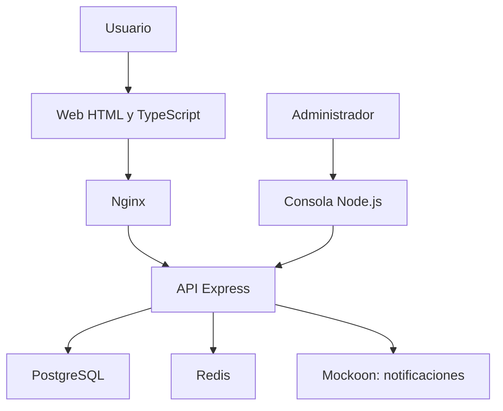
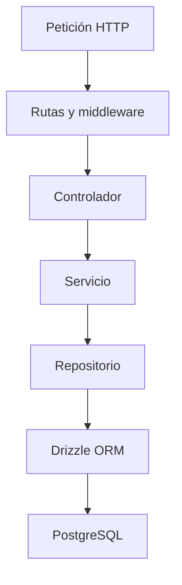
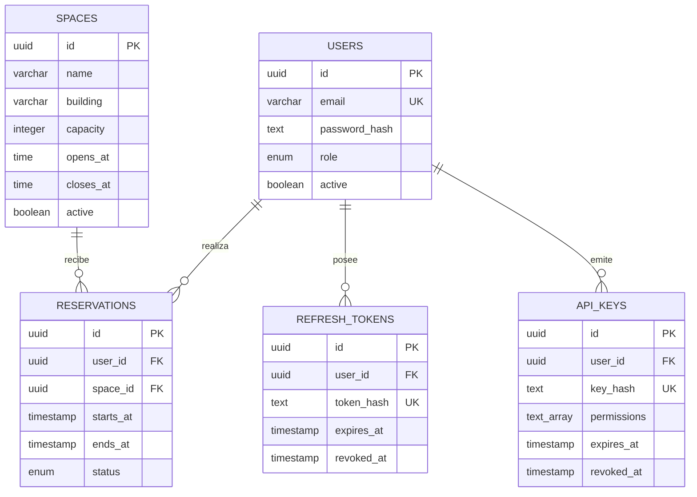
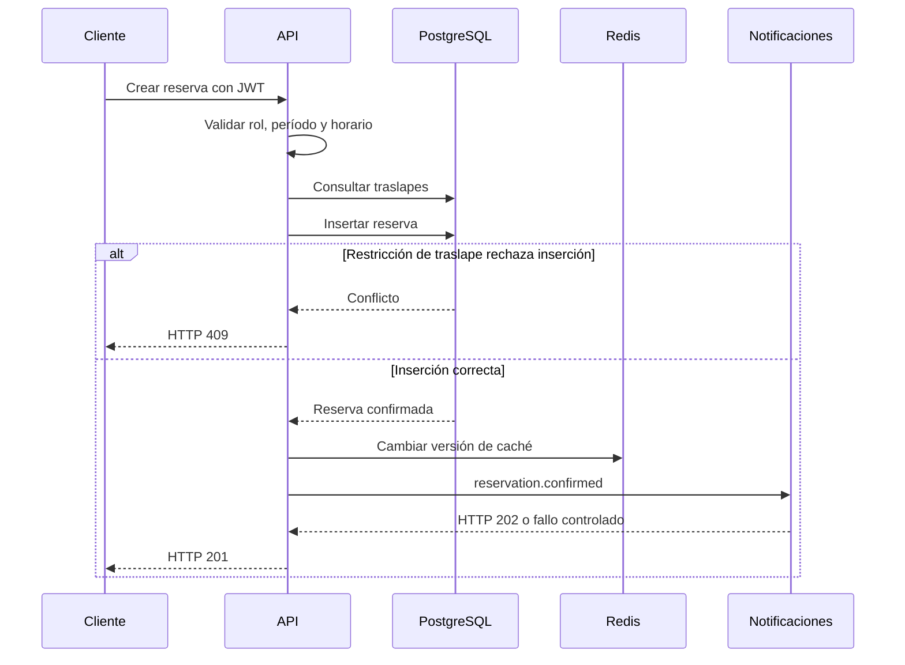

# Arquitectura de ReservaLab

## Objetivo

Permitir consultar disponibilidad y reservar laboratorios o salones,
aplicando roles, horarios y prevención de traslapes.

El sistema tiene dos clientes de usuario: web y consola administrativa.
Una pantalla informativa consulta la ocupación mediante API key.

## Vista de contexto y despliegue

Docker Compose administra cinco servicios: web, api, postgres,
redis y mockoon.

La web se compila con Vite y se publica mediante Nginx.
La CLI se ejecuta desde el equipo del administrador.

Los nombres `postgres`, `redis`, `mockoon` y `api` se resuelven
dentro de la red de Compose.

PostgreSQL conserva sus datos en un volumen.
La caché de Redis puede reconstruirse.

## Vista lógica por capas

### Rutas y middleware

Seleccionan la operación, verifican credenciales y aplican
restricciones por rol o permiso.

### Controladores

Interpretan parámetros y cuerpos, validan esquemas Zod,
invocan servicios y construyen las respuestas HTTP.

No ejecutan consultas mediante el ORM.

### Servicios

Aplican reglas de negocio: horarios, períodos futuros, propiedad
de reservas, conflictos e invalidación de caché.

Coordinan el acceso a repositorios y a servicios auxiliares
como notificaciones.

### Repositorios

Encapsulan las consultas y cambios persistentes mediante Drizzle.
No reciben objetos Request ni Response de Express.

### Paquete compartido

`packages/shared` contiene tipos y esquemas Zod reutilizados por
la API, la web y la CLI.

## Relación con MVC y servicios

La interfaz web representa la presentación.
Los controladores de Express atienden las acciones HTTP.
Los servicios y repositorios organizan el comportamiento y los datos.

La separación del servicio de notificaciones muestra una integración
orientada a servicios. Mockoon representa ese servicio externo.
La API conserva un único despliegue; no se presenta como un conjunto
de microservicios independientes.

## Vista de datos

El diagrama muestra los campos principales, no todas las columnas.

Las migraciones versionan el esquema.
El seed carga tres cuentas por rol y tres espacios iniciales.

Los espacios se eliminan lógicamente mediante `active=false`.
Las reservas se cancelan conservando su historial.

## Vista de comportamiento: crear reserva

La consulta previa permite detectar conflictos habituales.
La restricción de exclusión en PostgreSQL protege frente a
solicitudes simultáneas.

Las notificaciones tienen un tiempo límite de tres segundos.
Un fallo de envío no elimina la reserva confirmada.

## Seguridad

- Contraseñas almacenadas con bcrypt.
- Access tokens JWT de 15 minutos.
- Refresh tokens de 7 días, almacenados mediante hash y rotados.
- Validación de usuario activo en las solicitudes con JWT.
- Restricciones por rol y propiedad de reservas.
- API keys aleatorias almacenadas mediante SHA-256.
- Permisos específicos y revocación de API keys.
- Límite de solicitudes por clave mediante Redis.
- Validación de entradas mediante Zod.
- Credenciales de conexión mediante variables de entorno.
- Tokens del cliente web conservados en memoria.

## Atributos de calidad y verificación

| Atributo | Criterio verificable | Evidencia |
|---|---|---|
| Integridad | Dos reservas simultáneas para el mismo período producen una aceptación y un conflicto | Prueba de integración y restricción PostgreSQL |
| Seguridad | Roles y permisos no autorizados reciben 403; credenciales inválidas reciben 401 | Pruebas HTTP |
| Eficiencia | Segunda consulta idéntica utiliza caché durante su vigencia de 60 segundos | X-Cache HIT y pruebas |
| Consistencia de lectura | Una reserva creada o cancelada invalida la consulta anterior | Prueba de integración |
| Mantenibilidad | Cobertura mínima de 70 % en líneas, ramas, funciones y sentencias | Umbrales de Vitest |
| Portabilidad | Los cinco servicios arrancan con Compose | docker compose up y healthchecks |
| Observabilidad | Health comprueba PostgreSQL y Redis, con 200 o 503 | Endpoint y pruebas unitarias |
| Actualización de pantalla | La web consulta ocupación cada 30 segundos | Temporizador de la interfaz |

Estos criterios no representan una medición de rendimiento
bajo carga. No se ha establecido un SLA de latencia.

## Limitaciones y mejoras

- La invalidación de caché es global y puede provocar recargas
  de consultas que no cambiaron.
- Un fallo de Redis durante una invalidación puede devolver un error
  después de que PostgreSQL haya confirmado el cambio.
- Las notificaciones no tienen cola durable ni reintentos.
- La pantalla puede mostrar datos de caché de hasta 60 segundos.
- Cerrar sesión revoca el refresh token; el access token conserva
  su vencimiento normal.
- La configuración está orientada a demostración local.
  Un despliegue público requiere HTTPS y gestión adecuada de secretos.